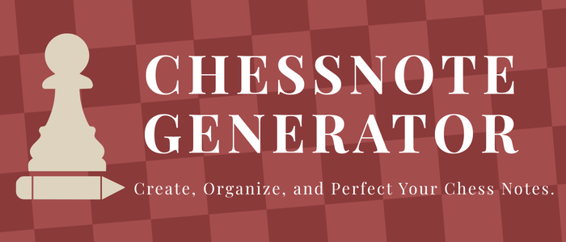
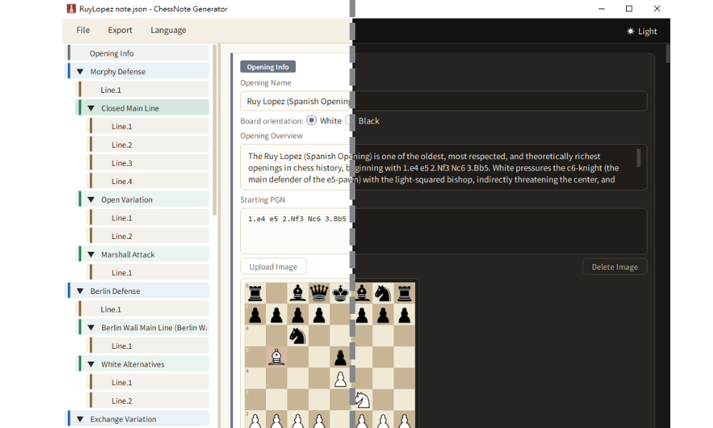
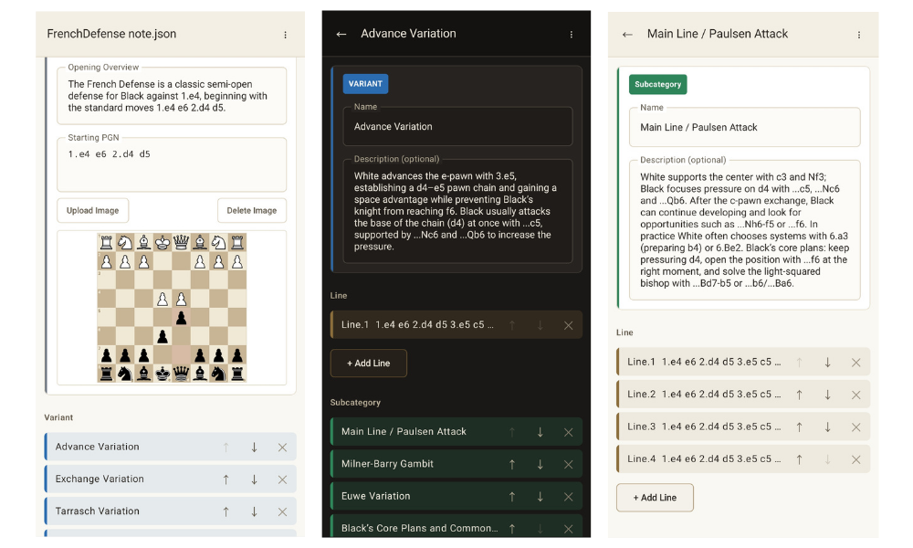
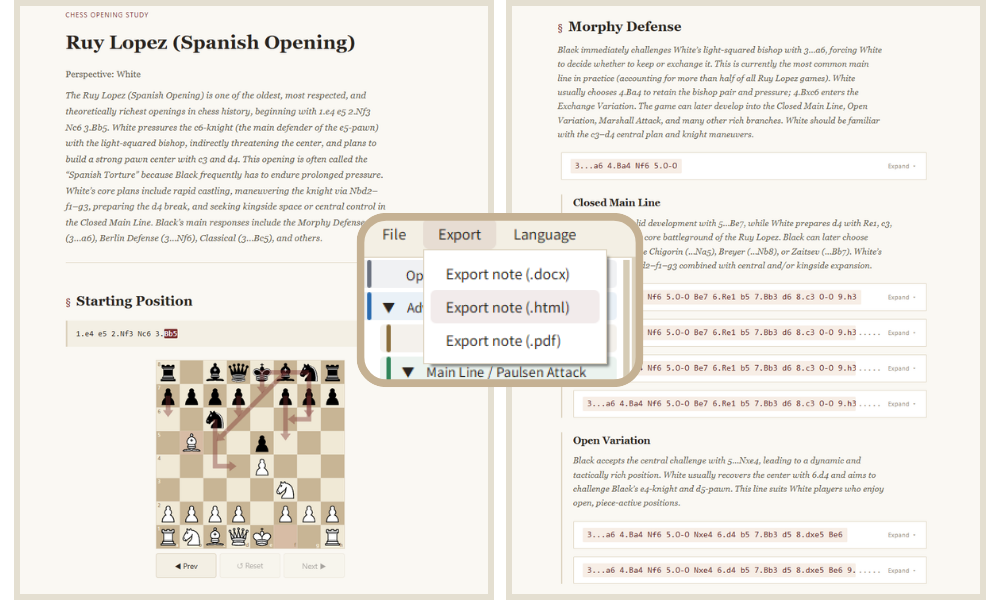

<!---------------- LINKS_START -------------------->

[release_badge]: https://img.shields.io/github/release/294Ryan/ChessNote-Generator?color=red&label=Release&style=flat-square
[star_badge]: https://img.shields.io/github/stars/294Ryan/ChessNote-Generator?color=yellow&style=flat-square
[license_badge]: https://img.shields.io/badge/License-GPL--3.0-orange?color=orange&style=flat-square
[os_badge]: https://img.shields.io/badge/Supported-Windows_10%2B_%7C_Android_8.0%2B-blue?style=flat-square
[contributors_badge]: https://contrib.rocks/image?repo=294Ryan/ChessNote-Generator

[last_release]: https://github.com/294Ryan/ChessNote-Generator/releases/latest
[release]: https://github.com/294Ryan/ChessNote-Generator/releases
[star]: https://github.com/294Ryan/ChessNote-Generator/stargazers
[license]: https://github.com/294Ryan/ChessNote-Generator/blob/main/LICENSE
[contributors]: https://github.com/294Ryan/ChessNote-Generator/graphs/contributors
[contributing]: https://github.com/294Ryan/ChessNote-Generator/blob/main/CONTRIBUTING.md

<!----------------- LINKS_END --------------------->

<div align='center'>
  
  <br>
  <h1><b>ChessNote Generator</b></h1>
  <h3>Structure your chess opening notes and export them as interactive HTML, PDF, or Word. For Windows and Android.</h3>

  
  
  
  
  <br>

  [![Release][release_badge]][last_release]
  [![Stars][star_badge]][star]
  [![License][license_badge]][license]
  ![Supported OS][os_badge]
  <br>

  [Quick Start](#quick-start) | [Features](#features) | [Screenshots](#screenshots) | [Usage](#usage) | [FAQ](#faq) | [License](#license) | [Contributors](#contributors)

</div>

---

## **Quick Start**

> [!NOTE]
> System Requirements:  
> **Windows**: Windows 10 or above  
> **Android**: Android 8.0 (API 26) or above  
> **Python**: 3.13 or above (only required when running from source)  

- **Direct Download (Recommended)**: Go to [Release][release] and download the file for your platform.
  - **Windows**: `ChessNoteGenerator.exe`. Single file, no installer and no Python required. Launch it directly. If Windows SmartScreen appears, click **More info**, then **Run anyway**.
  - **Android**: `ChessNoteGenerator-android-installer.apk`. Open it on the device. If Android shows a security warning or blocks the install, allow the installation (see the [FAQ](#faq)).
- **Run from Source (Windows)**:
  ```
  git clone https://github.com/294Ryan/ChessNote-Generator.git
  cd ChessNote-Generator/desktop
  pip install -r requirements.txt
  python main.py
  ```
- **Build the Android App from Source**: See [CONTRIBUTING][contributing].

---

## **Features**
- **Structured notes**: Organize an opening as **Opening → Variant → Subcategory → Line**. Lines can also sit directly under a Variant.
- **Board images from PGN**: Every level can show a board image generated from its PGN. Upload your own image or delete the image per item.
- **PGN validation**: Invalid PGN is flagged as you type, with the move that failed.
- **Continuation lines**: A Line can be a full PGN or only the moves that follow the Starting PGN.
- **Reordering**: Drag and drop on desktop (same level and same type only). Up/down buttons on Android.
- **Three export formats**: **HTML**, **PDF**, and **DOCX**.
- **Interactive HTML notes**: Play through the registered lines on a board, directly in the browser. Details below.
- **Re-editable output**: Exported `.html` notes embed the project data, so you can open them in the app and keep editing.
- **Cross-platform files**: `.json` drafts and `.html` notes open on both Windows and Android.
- **9 languages**: 繁體中文, 简体中文, English, 日本語, 한국어, Español, Русский, Deutsch, Français.
- **Light and dark themes** on both platforms.
- **Fully offline**: No network access. Exported HTML is one self-contained file.
- **Android extras**: Welcome screen on first launch, in-app preview of the note, automatic backup and restore of unsaved work, and remembered language and theme.

<details>
<summary><b>Interactive HTML board</b></summary>

<br>

- **Prev / Next / Reset** buttons, plus click-to-move and drag-and-drop on desktop browsers and phones.
- **Only registered moves** are playable. There is no engine. Arrows show every registered next move from the current position, with the board's own PGN move in the main color.
- **Live move marking**: The current move is highlighted in the PGN text. Click any move in the PGN to jump the board to it.
- **Matching Lines**: Moving pieces on the Starting Position board lists the Lines that match the current position. Click one to jump to its section. When more than 4 match, a "view all" toggle appears.
- **Collapsible Line cards**: Each Line collapses into a single PGN row. The print stylesheet expands everything.
- **Responsive layout** for phones and desktops.

</details>

---

## **Screenshots**

**Desktop editor**



**Android editor**



**Exported HTML note**



---

## **Usage**

**Note structure**

| Level | Contains |
| :-- | :-- |
| **Opening** | Name, overview, board orientation (White / Black), Starting PGN, optional image |
| **Variant** | Name, optional description, Lines, Subcategories |
| **Subcategory** | Name, optional description, Lines |
| **Line** | PGN, optional image |

**File types**

| Type | Use |
| :-- | :-- |
| **Draft file** (`.json`) | Working file for editing. Opens on Windows and Android. |
| **Note** (`.html`) | Interactive output. Can also be opened in the app for further editing. |
| **Word / PDF** (`.docx`, `.pdf`) | Output only. Cannot be reopened in the app. |

**Writing Lines**

A Line starting with `1.` is read as a complete PGN. A Line starting with any other move number is read as a continuation of the Starting PGN and must include move numbers.

```
Starting PGN:  1.e4 e5 2.Nf3 Nc6 3.Bb5
Line:          3...a6 4.Ba4 Nf6 5.O-O
```

<details>
<summary><b>Windows menu and shortcuts</b></summary>

<br>

| Menu | Item | Shortcut |
| :-- | :-- | :-: |
| **File** | Open note / draft file | `Ctrl+O` |
| **File** | Save changes | `Ctrl+S` |
| **File** | Save as draft file (.json) | `Ctrl+Shift+S` |
| **Export** | Export note (.docx) / (.html) / (.pdf) | |
| **Language** | Pick one of the 9 languages | |
| Top right | Light / dark theme toggle | |

</details>

<details>
<summary><b>Android menu</b></summary>

<br>

Open the **⋮** menu in the top bar:

- **New note**
- **Open note / draft file**
- **Save changes** (hidden for a new note that has no file yet)
- **Save as draft file (.json)**
- **Preview note**
- **Export note** as `.html`, `.docx`, or `.pdf`
- **Language** and **theme toggle**

</details>

---

## **FAQ**

<details>
<summary><b>Windows shows "Windows protected your PC" when I launch the exe</b></summary>

<br>

Click **More info**, then **Run anyway**. SmartScreen shows this screen for executables it does not recognize.

</details>

<details>
<summary><b>Android blocks or warns me when I install the APK</b></summary>

<br>

The APK is installed outside an app store, so Android may ask you to allow installs from the app you opened it with (your browser or file manager), and a security prompt such as Play Protect may appear. Allow the installation to continue. The exact wording and menu path differ between Android versions and manufacturers.

</details>

<details>
<summary><b>Which file should I keep to continue editing later?</b></summary>

<br>

Keep the `.json` draft or the exported `.html` note. Both can be opened with **Open note / draft file**. `.docx` and `.pdf` files cannot be opened again.

</details>

<details>
<summary><b>What does "Save changes" do?</b></summary>

<br>

It writes back to the file you opened: a `.json` draft is saved as `.json`, and a `.html` note is regenerated and overwritten. A note with no file yet goes to **Save as draft file** instead.

</details>

<details>
<summary><b>Can I move files between Windows and Android?</b></summary>

<br>

Yes. `.json` drafts and `.html` notes are compatible across both apps.

</details>

<details>
<summary><b>The app says "Invalid file". What does that mean?</b></summary>

<br>

The file is not a valid note (`.html`) or draft (`.json`) created by this app. Every opened file is validated before it replaces your current content, so a rejected file leaves your open note untouched.

</details>

<details>
<summary><b>Why can't I play any move on the HTML board?</b></summary>

<br>

The board only allows moves that exist in your notes. There is no engine. Pieces that cannot move in a registered line snap back.

</details>

<details>
<summary><b>Why are some Line PGNs shorter in the HTML note?</b></summary>

<br>

The HTML note hides the moves that repeat the Starting PGN and shows only where the Line differs. The DOCX export keeps the full PGN.

</details>

<details>
<summary><b>Why is my file large?</b></summary>

<br>

Uploaded images are shrunk to at most 1200 px on the longest side and stored inside the file. Notes with many uploaded images grow accordingly. Auto-generated board images are not stored as image data in `.json` drafts.

</details>

<details>
<summary><b>Why does the desktop app always start in English?</b></summary>

<br>

The desktop app does not remember the language or theme between launches. Pick them again from the **Language** menu and the theme toggle. The Android app remembers both.

</details>

<details>
<summary><b>How do I export a PDF on Android?</b></summary>

<br>

Choose **Export note (.pdf)**. The system print screen opens. Select **Save as PDF** and pick a location.

</details>

<details>
<summary><b>Is my unsaved work lost if I close the Android app?</b></summary>

<br>

No. The app backs up your current note when you leave it and restores it on the next launch. This backup is separate from saving a file. Use **Save changes** or **Save as draft file** to keep a copy you control.

</details>

---

## **License**
License: [GPL-3.0 License][license]
> [!WARNING]
> Please use the contents of this project within the scope permitted by the license. Users are solely responsible for any consequences resulting from improper or negligent use.

---

## **Contributors**
See [CONTRIBUTING][contributing] to get involved.

[![Contributors][contributors_badge]][contributors]

<br><br>
<div align="center">
  <a href="#top">Back to top</a>
</div>